<div align="center">

# Animators Hive Hub: a web application for sharing and discussing animation

Level 5 Diploma in Computing: Computing Project final report

Edem Angel Edem Hogan (P0013366)

AfriHUB

</div>

## Abstract

This report describes Animators Hive Hub, a web application that lets animators publish short animations and lets other people find, watch, upvote and comment on them. The scope covers account creation and sign-in with email or Google, an upload flow for video and thumbnails, a discover feed with sorting and search, animation pages, public and private profiles, playlists and communities. The work followed an iterative approach. A first build in June 2025 was a React single-page application on Supabase. After a long pause, the system was rebuilt from September 2026 as a SvelteKit application on Cloudflare Workers, with records in a D1 database and media in R2 storage. The analysis, design, implementation and testing are documented, together with project, risk and configuration management. Most functional aims were met, and the application is deployed. Community messaging, which the proposal listed, was not built. All 81 black-box test cases passed.

## Contents

- 1 Introduction
  - 1.1 The system developed
  - 1.2 Justification for the method
  - 1.3 The solution that emerged
  - 1.4 Aims
  - 1.5 Objectives
  - 1.6 Overview of the remaining chapters
- 2 Analysis
  - 2.1 Introduction
  - 2.2 Requirements
    - 2.2.1 Functional requirements
    - 2.2.2 System-wide non-functional requirements
  - 2.3 Use cases
  - 2.4 Architecture
    - 2.4.1 Interfaces with other systems
    - 2.4.2 Technical architectures for development and implementation
    - 2.4.3 Initial class diagram
  - 2.5 Conclusion
- 3 Design
  - 3.1 Introduction
  - 3.2 Structural model
  - 3.3 Behavioural model
    - 3.3.1 Animation upload
    - 3.3.2 Google sign-in with PKCE
    - 3.3.3 Upvote toggle
  - 3.4 Justification of design approach
  - 3.5 Conclusion
- 4 Implementation
  - 4.1 Introduction
  - 4.2 Choice of programming language
  - 4.3 System cutover from development to implementation architecture
  - 4.4 Data migration
  - 4.5 Training
  - 4.6 Conclusion
- 5 Other project issues
  - 5.1 Introduction
  - 5.2 Project management
  - 5.3 Risk management
  - 5.4 Configuration management
  - 5.5 Testing
  - 5.6 Conclusion
- 6 Conclusion
  - 6.1 Summary
  - 6.2 Evaluation of aims and objectives
  - 6.3 Evaluation of the work
  - 6.4 Future development
  - 6.5 Final reflection
- References
- Appendices
  - Appendix A: Requirements catalogue
  - Appendix B: Use case descriptions
  - Appendix C: Detailed class definitions
  - Appendix D: Test scripts
  - Appendix E: User guide
  - Appendix F: Source code overview

**List of Figures**

- Figure 1: Use case diagram (Section 2.3)
- Figure 2: Interfaces with other systems (Section 2.4.1)
- Figure 3: Technical architecture for development and implementation (Section 2.4.2)
- Figure 4: Initial class diagram (Section 2.4.3)
- Figure 5: Class diagram (Section 3.2)
- Figure 6: Animation upload sequence (Section 3.3.1)
- Figure 7: Google sign-in sequence (Section 3.3.2)
- Figure 8: Upvote toggle sequence (Section 3.3.3)
- Figure 9: System cutover from development to implementation (Section 4.3)
- Figure 10: Data migration (Section 4.4)
- Figure 11: Gantt chart of the build, 26 September to 21 October 2026 (Section 5.2)
- Figure 12: Repository layout (Section 5.4)
- Figure 13: Landing page (Appendix E.1)
- Figure 14: Sign-up (Appendix E.2)
- Figure 15: Discover feed (Appendix E.3)
- Figure 16: Upload an animation (Appendix E.4)
- Figure 17: Animation page: upvote and comment (Appendix E.5)
- Figure 18: Playlists (Appendix E.6)
- Figure 19: Communities (Appendix E.7)
- Figure 20: Your profile (Appendix E.8)
- Figure 21: Mobile view (Appendix E.9)
- Figure 22: Full source tree (Appendix F)

**List of Tables**

- Table 1: Functional requirements (Section 2.2.1)
- Table 2: System-wide non-functional requirements (Section 2.2.2)
- Table 3: Programming language and platform options (Section 4.2)
- Table 4: Project risks (Section 5.3)
- Table 5: Test evidence summary (Section 5.5)
- Table 6: Evaluation of aims and objectives (Section 6.2)
- Table 7: Requirements catalogue (Appendix A)
- Table 8: Unit Test 1, Account (Appendix D)
- Table 9: Unit Test 2, Session and Google sign-in (Appendix D)
- Table 10: Unit Test 3, Animation upload (Appendix D)
- Table 11: Unit Test 4, Upvote (Appendix D)
- Table 12: Unit Test 5, Comment (Appendix D)
- Table 13: Unit Test 6, Playlist (Appendix D)
- Table 14: Unit Test 7, Community (Appendix D)
- Table 15: Unit Test 8, Profile (Appendix D)
- Table 16: Integration Test Suite 1.1, functional (Appendix D)
- Table 17: Integration Test Suite 1.2, non-functional security (Appendix D)
- Table 18: Integration Test Suite 1.3, non-functional usability and accessibility (Appendix D)
- Table 19: Key source files (Appendix F)

**List of Appendices**

- Appendix A: Requirements catalogue
- Appendix B: Use case descriptions
- Appendix C: Detailed class definitions
- Appendix D: Test scripts
- Appendix E: User guide
- Appendix F: Source code overview

## Acknowledgements

I thank my supervisor for guidance on the proposal and on the build, and the staff at AfriHUB, the study centre, for their support during the course.

## 1 Introduction

Animators publish their work on general platforms such as YouTube, Instagram and X, where animation competes with every other kind of video and post. Animators with a small audience are hard to find, and people who want animation have no single place to look. Animators Hive Hub is a web application in which animation is the subject, where animators can share their work, be found and discuss it.

### 1.1 The system developed

A visitor who is not signed in can open the landing page, animation pages, public profiles and the communities list. A signed-in member can upload an animation with a video, an optional thumbnail, a title, a description and an optional community. Members browse a feed sorted by newest or most upvoted and searched by title and description. They upvote, comment, keep playlists, create and join communities, and edit their profiles. Owners can edit and delete their animations, and authors can delete their comments.

The proposal listed a feature to send a message to a community. It was not built. Discussion takes place through comments. There is no moderation, reporting, password reset or email verification, because the system sends no email.

### 1.2 Justification for the method

The project used an agile, iterative approach, with requirements prioritised by MoSCoW as used in the DSDM method (Agile Business Consortium, 2014; Clegg and Barker, 1994). I chose it over waterfall. Sommerville (2016) describes waterfall as fixing requirements before design, which suits stable requirements. This project's platform was not stable. The June 2025 React and Supabase build was left for fifteen months, and when work resumed in September 2026 the platform moved to Cloudflare, the code to SvelteKit, and the data layer changed twice before settling on D1 and R2. A complete plan written at the start would have been wrong by the time it was needed. The agile values of working software and of responding to change (Beck et al., 2001) describe that situation.

The method was applied loosely. The prototype was not timeboxed. From September 2026 each block of work was a plan file whose steps needed a passing check before they were marked done. The critical plan ran about seventy minutes on 6 and 7 October 2026, and the next plan logged 27 steps on 7 October 2026.

### 1.3 The solution that emerged

The final system is a server-rendered application built with SvelteKit 2, Svelte 5 and TypeScript, styled with Tailwind CSS 4, and running as a Cloudflare Worker. Records are held in a D1 database named ahh, and video, thumbnail and avatar files in an R2 bucket named ahh. Google sign-in uses the arctic library with PKCE. Development runs the Vite server on a Linux computer with Node 22. The application is deployed at https://animators-hive-hub.apexlinks.workers.dev, and a push to main triggers Cloudflare Workers Builds.

### 1.4 Aims

- To give animators a place to publish their animations and be found for their work.
- To let visitors and members discover, comment on and upvote animations, and organise them into playlists and communities.
- To give each animator control of their own work, including editing and deleting it.
- To deliver a publicly deployed application that one developer can build and operate on a hosted platform.

### 1.5 Objectives

Each objective is measurable and due by 21 October 2026. Chapter 6 evaluates them.

- O1: a member can upload a video of up to 50 MB with a title, description and thumbnail, and see it on the feed (end-to-end test; integration suite 1.1).
- O2: a visitor can sign up with email and password, or sign in with Google, and sessions end on sign-out and password change (unit tests 1 and 2).
- O3: the feed sorts by newest or most upvoted, searches title and description, and pages 20 items (smoke script).
- O4: members can upvote, comment, and delete their own comments (unit tests 4 and 5).
- O5: members can create playlists and communities, and joining or leaving updates the member count (unit tests 6 and 7).
- O6: rate limits of 30 authentication requests, 120 writes and 30 uploads per minute apply, invalid input is rejected, and other people's content returns 403 (integration suite 1.2).
- O7: the application is deployed at a public URL from main (deployment check in plan/next.log).

### 1.6 Overview of the remaining chapters

Chapter 2 gives the analysis. Chapter 3 gives the design. Chapter 4 covers implementation, data migration and training. Chapter 5 covers project management, risk, configuration management and testing. Chapter 6 evaluates the work. The appendices hold the catalogues, descriptions, class definitions, test scripts, user guide and source overview.

## 2 Analysis

### 2.1 Introduction

This chapter sets out what the system must do and how it is arranged. The requirements come from the proposal, the problem in Chapter 1, and my own use and testing of the working system. I carried out no interviews or surveys with animators, so the requirements reflect my judgement, not measured user needs. The full catalogue and use case descriptions are in Appendices A and B.

### 2.2 Requirements

#### 2.2.1 Functional requirements

Table 1 gives each functional requirement with its MoSCoW priority and any supporting non-functional requirement. Must covers accounts, upload, the feed, the animation page, upvotes and comments. Should adds organisation and control. Community messaging is Could, as it was not expected to be finished. Won't covers reporting, moderation, follows, notifications, replies, administration, password reset and email verification. The last two are excluded because the system sends no email, as recorded in wip-plans/next.plan.json on 7 October 2026.

**Table 1: Functional requirements**

| ID | Functional requirement | Priority | Supporting non-functional requirement |
|---|---|---|---|
| FR1 | Register with email, username and password | Must | NFR1, NFR4 |
| FR2 | Sign in and sign out with email and password | Must | NFR2, NFR3 |
| FR3 | Sign in with a Google account | Should | NFR2 |
| FR4 | Upload an animation: video, optional thumbnail, title, description, optional community | Must | NFR3, NFR5 |
| FR5 | Browse the discover feed with new and top sorts, search and load more | Must | NFR5 |
| FR6 | View an animation page with player, description and comments | Must | NFR6, NFR7 |
| FR7 | Edit or delete an animation the member owns | Should | NFR4 |
| FR8 | Upvote an animation and remove the upvote | Must | NFR3, NFR4 |
| FR9 | Comment on an animation and delete one's own comment | Must | NFR4 |
| FR10 | Create, rename and delete playlists; add and remove animations | Should | NFR4 |
| FR11 | Browse, search, create, join and leave communities | Should | NFR4 |
| FR12 | View public profiles; edit one's own profile and avatar | Should | NFR4, NFR8 |
| FR13 | Change password and delete account | Should | NFR2 |
| FR14 | Send a message to a community | Could (not delivered) | NFR3 |

#### 2.2.2 System-wide non-functional requirements

Each target in Table 2 is taken from the source code so that it can be checked. Where a figure is a design bound rather than a measured result, the table says so.

**Table 2: System-wide non-functional requirements**

| ID | Category | Requirement and measurable target |
|---|---|---|
| NFR1 | Security | Passwords are stored as PBKDF2-SHA256 hashes, 80,000 iterations, 256-bit output, random salt. |
| NFR2 | Security | The session token is 32 random bytes in an httpOnly, SameSite Lax cookie for 30 days. Only its SHA-256 hash is stored. Sessions end on sign-out, password change and deletion. |
| NFR3 | Security | Rate limits per 60 seconds: 30 authentication requests per IP, 120 writes per user, 30 uploads per user. Excess requests receive HTTP 429. |
| NFR4 | Integrity | Inputs are checked on the server against shared limits, such as a title of at most 100 characters. Owner-only actions return 403 to other users. |
| NFR5 | Performance | Feed pages hold at most 20 items; the offset is capped at 2,000; uploads are capped at 50 MB video and 5 MB image. These are design bounds; no timing benchmark was run. |
| NFR6 | Usability | The layout works at 375 by 667 pixels without horizontal scrolling. Light and dark themes are available. |
| NFR7 | Accessibility | Dialogs trap focus and close on Escape; icon-only buttons are named. The target is WCAG 2.1 (W3C, 2018). |
| NFR8 | Privacy | Public pages never show an email address. |
| NFR9 | Maintainability | Strict TypeScript, lint and check scripts, all SQL in one module, numbered migrations. |
| NFR10 | Deployability | A push to main produces a Cloudflare Workers build and deployment. |

The security requirements follow the OWASP Top 10 (OWASP Foundation, 2021): NFR4 addresses broken access control, and NFR1 to NFR3 address authentication failures. NFR2 and NFR3 shape the design most, because they require a server-side session store and one rate limit applied in one place. NFR7 is a target, not a finished claim.

### 2.3 Use cases

Figure 1 is one use case diagram for the whole system. Guest is a visitor who is not signed in, Member is a signed-in animator, and Google is an external actor used only in sign-in. Member is a specialisation of Guest, so it inherits the guest use cases. Each oval carries an identifier that matches Appendix B. The notation follows Fowler (2004).

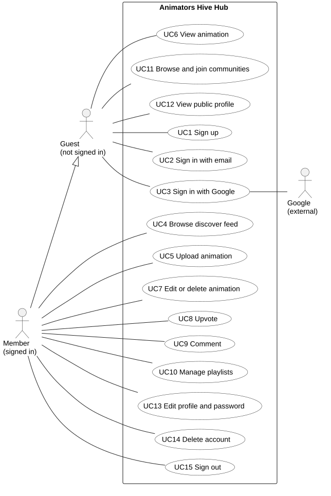

*Figure 1: Use case diagram for Animators Hive Hub*

Discovery is open to visitors so that work can be found before sign-up. Changes to data are reserved for members. Each Must requirement maps to a use case: FR1 to UC1, FR2 to UC2 and UC15, FR4 to UC5, FR5 to UC4, FR6 to UC6, FR8 to UC8 and FR9 to UC9.

### 2.4 Architecture

#### 2.4.1 Interfaces with other systems

The system exchanges data with the browser, Google, Cloudflare's D1 and R2 services, and GitHub. Figure 2 shows the flows and their direction.


*Figure 2: Interfaces with other systems*

The browser sends forms, JSON and raw file bodies to the Worker, which returns HTML, JSON and media. Google sign-in is the only flow to an identity provider. The Worker redirects the browser to Google with a state value and a PKCE challenge, then exchanges the returned code with the stored verifier and reads the email, name, picture and email-verified flag. This is OAuth 2.0 (Hardt, 2012) with PKCE (Sakimura, Bradley and Agarwal, 2015). Only the Worker talks to D1 and R2. Clients see /media/ URLs whose keys are random UUIDs, never the bucket itself. No other external service receives data: there is no email, payment or analytics provider.

#### 2.4.2 Technical architectures for development and implementation

Figure 3 separates the author's computer from the Cloudflare implementation, following the pattern of developing on a laptop and transferring to a commercial server.


*Figure 3: Technical architecture for development and implementation*

The development hardware is one Linux computer with an x64 processor. The implementation has no hardware the author manages, because Cloudflare runs the Worker, D1 and R2. The software is Node 22, pnpm with a lockfile, SvelteKit 2.70.3, Svelte 5.57.1, Vite 7.3.6, TypeScript 5.9.3, Tailwind CSS 4.3.3, the Cloudflare adapter 7.2.9 and Wrangler 4.147.0. The Worker runs on the Workers runtime (Cloudflare, 2026c), records live in D1 (Cloudflare, 2026a) and media in R2 (Cloudflare, 2026b). Local emulation does not reproduce the production network, so network-dependent behaviour can differ.

#### 2.4.3 Initial class diagram

Figure 4 is the initial class diagram, derived from the use cases. It has eight classes, with no attributes or methods, as the module specifies.

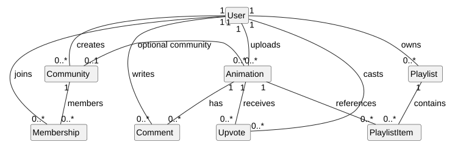

*Figure 4: Initial class diagram*

Several relationships were unclear. It was not settled whether a community's creator is also a member, or how the optional community association's multiplicities should be fixed against a schema. It was also unclear whether upvotes and comments needed identity of their own. Some classes were missing. There was no session class, because the first build relied on a hosted authentication service; server-side sessions became necessary on D1. Counts of votes, comments and members were absent and were added later for sorting. Media was held as URLs on Animation and User, so it needed no class. Messaging has no class because it was never designed.

### 2.5 Conclusion

The analysis gave 14 functional requirements with MoSCoW priorities, ten system-wide requirements with measurable targets, one use case diagram and an initial class diagram. Three questions were left open: whether the creator is a member, the multiplicities of the community association, and the place of sessions, which the analysis had not considered. Chapter 3 answers the first two and adds the third. Community messaging was classed as Could and was not built.

## 3 Design

### 3.1 Introduction

The structural model is the completed class diagram in Section 3.2. The behavioural model in Section 3.3 shows the three flows that cross the most components: animation upload, Google sign-in and the upvote toggle. I took each sequence from its use case and checked it against the route handler, data function and hook that implement it. Appendix C gives the full class definitions.

### 3.2 Structural model

Figure 5 is the completed class diagram. It keeps the eight classes and association labels of Figure 4, adds the session class, and shows the attributes with their types, the counters and the operations from the server modules. Appendix C gives the same definitions in prose, and maps each attribute to its short column name in the migrations.

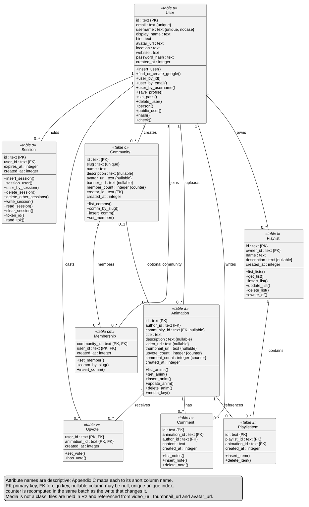

*Figure 5: Class diagram*

I moved from the initial diagram in four steps: I mapped each migration table to a class, checked each association against its foreign key and cascade rule, added the classes and attributes the schema needed, and documented the short column names in the SQL. The schema brought four changes. A session table was added, keyed by the SHA-256 hash of a random cookie value. Counters for upvotes and comments on animations, and for members on communities, were added and recomputed in the same batch as each write. Migration 0003 made membership explicit and backfilled every existing creator as a member, which settled the open question in Section 2.4.3. Deleting a user cascades to everything they own or joined, while deleting a community clears the community reference on its animations.

Figure 5 uses descriptive attribute names, with the table name in each class header. Primary and foreign keys are marked, and the three recomputed counters are labelled as counters. Media is not a class, so it appears only as the video, thumbnail and avatar URL attributes. The community avatar and banner columns exist but are never written. Section 6.3 records these gaps.

### 3.3 Behavioural model

#### 3.3.1 Animation upload

Figure 6 shows the upload flow. The file goes first as a raw body to /api/media, which checks the content type and size, stores the file under a random UUID and returns its URL. The metadata then goes as JSON to /api/animations. The server checks the title and description, and confirms that each media URL matches the UUID pattern, so a client cannot point an animation at an arbitrary key. The flow was gathered from UC5, the upload components and the route handlers. If no thumbnail is chosen, the browser captures a still frame and uploads it the same way, and a failure there saves the animation without one.

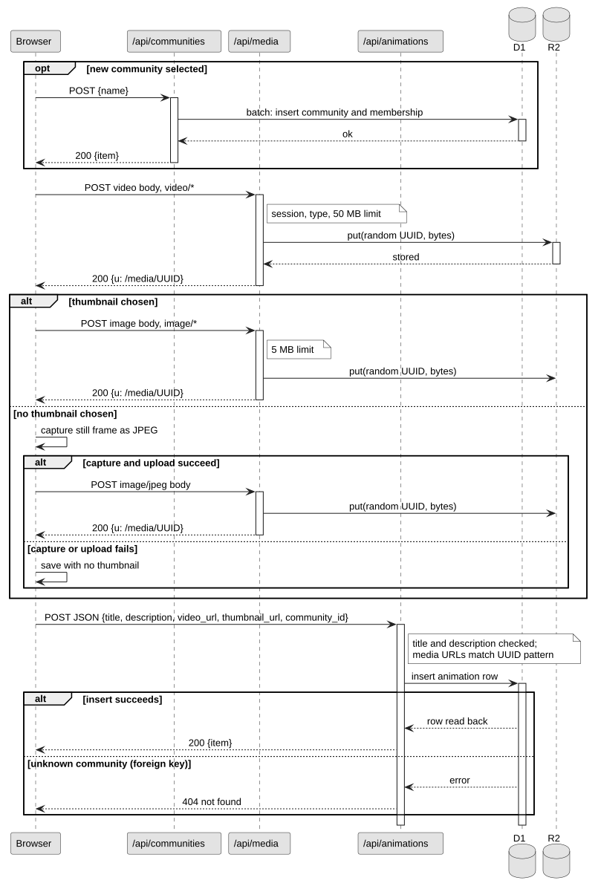

*Figure 6: Animation upload sequence*

A new community, if one is created, is made first and its identifier passed in the metadata request. A missing community reference returns a foreign key error, which the route maps to 404.

#### 3.3.2 Google sign-in with PKCE

Figure 7 shows Google sign-in, which follows the OAuth 2.0 code grant (Hardt, 2012) with PKCE (Sakimura, Bradley and Agarwal, 2015). It was gathered from UC3, the two Google routes and the arctic client.

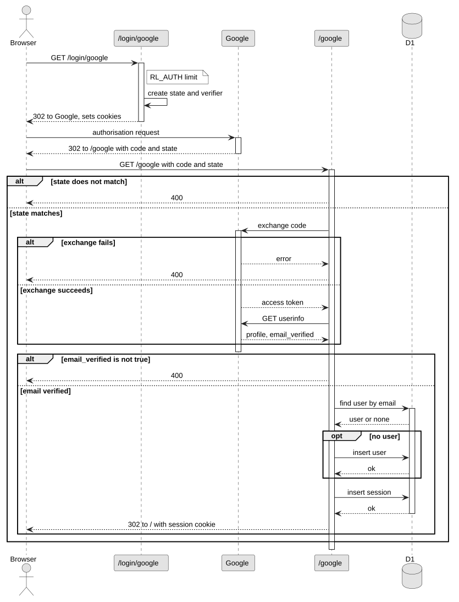

*Figure 7: Google sign-in sequence*

The state comparison stops forged callbacks. The verifier sits in an httpOnly cookie that lasts ten minutes. Unverified Google emails are rejected. Accounts are matched by lower-cased email, so an existing password account is signed in without its password. I accepted this because Google reports the address as verified, but it means control of the Google account controls the password account (Section 6.3).

#### 3.3.3 Upvote toggle

Figure 8 shows the upvote toggle, from UC8, the upvote button and the upvotes route. The button changes only after the server answers, and a signed-out visitor sees a message with no request sent.

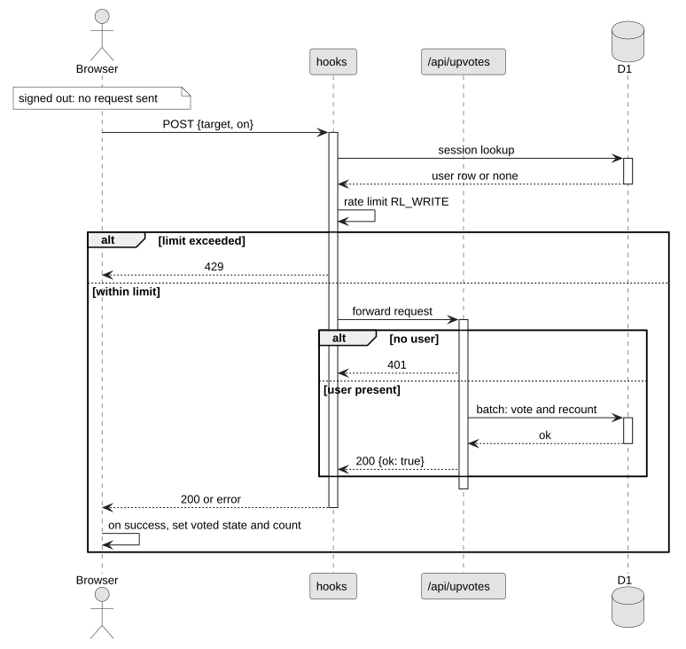

*Figure 8: Upvote toggle sequence*

The hook runs before every route, so each write is session-checked and rate-limited in one place. The vote change and the recount are sent as one batch. A repeated upvote is ignored rather than rejected, which makes the toggle safe to repeat.

### 3.4 Justification of design approach

Pages are rendered on the server, so the animation page's Open Graph tags are in the first response and a shared link previews without script. All records sit in one D1 database, which enforces foreign keys and cascades and supports batched statements, so the rules can be stated in the schema. All SQL is in src/lib/server/db.ts, which keeps the route handlers thin.

Sessions are stored in the database. The first version used a cookie signed with a secret, which cannot be ended on the server before it expires. A stored session lets sign-out, password change and deletion end sessions at once, at the cost of one lookup per request. Media stays in R2, separate from the records. Each owner-only action returns ok, not found or forbidden, and the route maps these to 200, 404 or 403, in line with the access-control guidance in OWASP (2021).

The denormalised counters are the weakest part. Each write must recount, and deleting a user does not recount other people's animations. Vector search with Gemini embeddings was tried and removed, because a title and description search met the requirement with one fewer external service and key.

### 3.5 Conclusion

The design gives a structural model (Figure 5) and three behavioural models (Figures 6, 7 and 8). The structure was developed from the initial diagram by reading the schema, and the behaviour was checked against the code paths. The choices of server-rendered pages, one database, server-side sessions, separate media storage and one rate limit follow from Table 2. The counter recount and the Google account-linking rule are known weaknesses, evaluated in Chapter 6.

## 4 Implementation

### 4.1 Introduction

This chapter covers the language, the cutover, the data migration and training. The main build took place between 6 and 9 October 2026.

### 4.2 Choice of programming language

The application is written in TypeScript with SvelteKit 2 and Svelte 5 (Svelte, 2026). TypeScript in strict mode (Microsoft, 2026) checks the data passed between server and browser. The validation rules in src/lib/rules.ts are imported by both routes and forms, so each limit is written once. SvelteKit keeps pages and JSON endpoints in one project, which suits the server-rendered design in Section 3.4, and its Cloudflare adapter targets the Workers runtime directly (Cloudflare, 2026c). Table 3 compares the options.

**Table 3: Programming language and platform options**

| Option | Strengths for this project | Reason not chosen |
|---|---|---|
| React and Vite single-page application (2025 prototype) | Familiar; already built | Pages render and fetch data in the browser, which made server-rendered pages harder |
| PHP and MySQL on a conventional web server | Common hosting; well documented | No edge runtime; the server must be maintained; storage built separately |
| TypeScript with SvelteKit on Cloudflare Workers (chosen) | Shared types and rules; server-rendered pages; D1 and R2 bindings | Fewer examples than React; the project follows the Svelte 5 runes API |

### 4.3 System cutover from development to implementation architecture

Figure 9 extends Figure 3, showing the code, schema, bindings and secrets moving from the development computer to the implementation, in the order they moved.


*Figure 9: System cutover from development to implementation*

The order is deliberate. A new migration is applied to the remote database before the push that depends on it, so deployed code never meets a schema it does not expect. The code then moves by git push to the mine remote on main, and Workers Builds deploys it. Each push is followed by a build check, and a failed build is attributed to the step that pushed it. The cutover also removed the Vectorize binding, the embedding code and the Gemini secret. Secrets are set with wrangler secret put and never committed. This keeps one repository as the source of truth, makes rollback a revert and push, and keeps secrets out of the history.

### 4.4 Data migration

Figure 10 shows the two parts of the data migration: the earlier build's data, and the schema of the new one.


*Figure 10: Data migration*

No data from the 2025 prototype was migrated. Its Supabase project no longer resolves, so its rows cannot be exported, and the plan records that there was nothing to migrate. Accounts and posts from the first build are therefore not in this system, and this report does not attempt to recover them. The schema is three numbered migrations, applied locally and then remotely as the plan requires. The third backfills memberships from existing communities, which shows how a future migration must treat existing rows. The R2 bucket was newly created, and no media was copied into it.

### 4.5 Training

The users are members, who upload and discuss, and visitors, who browse. The author is the only operator and learned the system by building it. No classroom or live training was given, and no external users were recruited, so there is no evidence of training outcomes. The guide in Appendix E has a section for each screen, with a screenshot and steps that use the interface's labels. Members can read it before first use. The application has no help subsystem, so the guide is the only help, a weakness recorded in Section 6.3.

### 4.6 Conclusion

The system was built with TypeScript and SvelteKit and deployed by a push to main, as Figure 9 shows. The schema is three numbered migrations. The prototype's data was lost with its hosted project, and that loss is recorded. Training is a self-study guide, and no external users were trained.

## 5 Other project issues

### 5.1 Introduction

This chapter covers project management, risk, configuration management and testing. Each section describes the technique, why it was chosen, and the results the repository supports.

### 5.2 Project management

Figure 11 is a Gantt chart of the build from 26 September to 21 October 2026. It is a work breakdown in five sections: analysis and set-up, design, implementation, testing and documentation. Each bar is a task dated from the commits in the repository or from the timestamps in the plan logs, and each diamond is a milestone, such as the first deployment on push on 7 October 2026 and the proposal draft on 12 October 2026. The chart shows when work happened, not a plan: the proposal's work breakdown structure was a heading with no content, so no planned schedule exists to compare against.

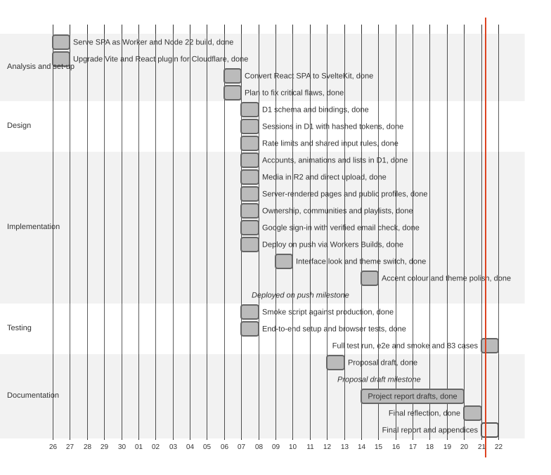

*Figure 11: Gantt chart of the build, 26 September to 21 October 2026*

The June 2025 prototype (two days, 37 commits) and the pause before September 2026 are left off the chart for scale. In the period shown, 73 commits were made: eight on 26 September, six on 6 October and 50 on 7 October, the day of the store switch, security, server rendering and ownership work. The remaining commits fall on 8, 9, 12, 14 and 20 October. The full test run on 21 October 2026 is the last item on the chart.

Work was managed through plan files in the repository. Each step has an outcome, instructions and a check command that must pass before the step is marked done, and completed steps are logged with a timestamp and commit hash. The critical plan had five steps; the next plan had nine groups and 27 logged lines, covering rendering, profiles, ownership, security, end-to-end tests and the production check. Scope decisions, such as excluding email, were written into the plans. The gate command stops a step being marked complete while its checks fail, and the files let the project resume after the pause.
### 5.3 Risk management

I managed risk in four steps: identify, analyse by likelihood and impact, plan containment and contingency, and monitor through the plan gates and history. No separate register was kept, so Table 4 is compiled from the plan files and commit history.

**Table 4: Project risks**

| Risk | Source | Likelihood | Impact | Containment | Contingency | What actually happened |
|---|---|---|---|---|---|---|
| A hosted dependency becomes unavailable (Supabase; Google sign-in) | Contractual and environmental | Medium | High | Schema and rules kept in the repository | Rebuild the data layer on D1 | Supabase no longer resolves; nothing migrated. Google sign-in not seen to fail |
| Work stops for a long period | Management and process | Medium | High | Repository kept deployable; plans kept in the repository | Restart from repository and proposal | Happened: no commits from 16 June 2025 to 25 September 2026 |
| Scope grows beyond what can be finished | Management and process | High | Medium | MoSCoW priorities; Won't list; scope decisions in plans | Defer or drop items | Partly happened: vector search tried and removed; messaging not built |
| Checks fail unnoticed | Management and process | Medium | Medium | Gate command before each step is marked done | Fix the application, not the check | Lint was red before the critical plan; later made to pass |
| The author cannot work for a period | Personnel | Medium | High | Small commits; plans that record progress | Reduce scope to Must requirements | No effect recorded |
| A session secret is exposed | Technical | Medium | High | Secrets kept out of the repository | Rotate; fail closed; move sessions to the database | Happened: secret in plan notes, removed 7 October 2026 |
| Denormalised counts drift | Technical | Medium | Medium | Recount in the same batch as each write | Maintenance recount | Partly happened: user deletion does not recount others' animations |
| Uploads abused or files accumulate | Technical | Medium | Medium | 50 MB and 5 MB limits; 30 uploads per minute | Delete orphaned objects; tighten limits | No abuse recorded; orphaned R2 objects remain possible |

The long pause could not be contained in full. The exposed session secret was contained by the database session design, with rotation as the response.

### 5.4 Configuration management

The project is managed in git, with the repository on GitHub. Figure 12 shows the top-level layout.

**Figure 12: Repository layout**

```text
animators-hive-hub/
  src/                  application: routes, components, lib (server and client)
  migrations/           numbered SQL schema files, 0001 to 0003
  tests/                e2e test files and a fixture video
  scripts/smoke.ts      API smoke test run with node
  docs/                 proposal, diagrams and this report
  plan/, wip-plans/     plan logs and plan files
  pnpm-lock.yaml        locked dependency versions
  wrangler.jsonc        Worker, D1, R2 and rate limit bindings
  .env.example          variable names only, committed
  .dev.vars, .env       local secrets, ignored by git
```

There is one branch, main. Pushes go to the remote named mine, the public fork 144126/animators-hive-hub, from which Workers Builds deploys. The remote named origin rejects pushes and is not used. Commits follow the conventional format, such as feat(auth), fix(ui), chore(plan) and docs(report). Migrations are numbered, the lockfile pins dependencies, and ignore rules keep secrets out of git. I chose git with conventional commits because the history is the audit trail for this report.

### 5.5 Testing

Testing is black-box, as the module requires. The unit and integration scripts in Appendix D use the NCC format. Three automated checks support them: the end-to-end suite in tests/core.e2e.ts and tests/mobile.e2e.ts, which runs four browser tests; scripts/smoke.ts, which runs more than sixty named API checks and stops at the first failure; and the lint, check and build scripts. All of them, and every case in Appendix D, were run on 21 October 2026 against the local development server. The project has no unit test runner, so the unit tests are documented scripts, not automated code.

**Table 5: Test evidence summary**

| Evidence | Scope | Status and result |
|---|---|---|
| End-to-end suite (4 tests) | Landing, sign-in focus, sign-up with upload, upvote and comment, phone layout | Passed, 4 of 4, on 21 October 2026 |
| Smoke script | API paging, search, votes, comments, playlists, communities, ownership, deletion | Passed: exit code 0, "smoke ok", on 21 October 2026 |
| Static checks | Formatting, types, build | Passed on 21 October 2026: svelte-check 0 errors and 0 warnings over 596 files; ESLint clean; production build succeeded |
| Unit test scripts 1 to 8 | Account through profile | 65 passed |
| Integration suites 1.1 to 1.3 | Functional flow, security, usability | 16 passed |

Google sign-in (case 2.4) was run with a real Google account in a browser against the local server. All tests ran on a local server, so they show the code is correct but do not measure production speed.

### 5.6 Conclusion

Plan files with gate commands made the work checkable and resumable. The risks that happened were met with containment or contingency. Configuration was kept in git with conventional commits, numbered migrations and a lockfile. Testing passed all 81 cases.

## 6 Conclusion

### 6.1 Summary

Animators Hive Hub is a deployed web application for sharing animation. Members upload animations with a video and thumbnail, upvote and comment, keep playlists, join communities and manage profiles. It was built with TypeScript and SvelteKit on Cloudflare, with D1 for records and R2 for media, and it was analysed, designed, managed and tested as Chapters 2 to 5 describe.

### 6.2 Evaluation of aims and objectives

**Table 6: Evaluation of aims and objectives**

| Objective or proposal item | Assessment | Evidence |
|---|---|---|
| O1 Upload with title, description and thumbnail; see it on the feed | Met | Upload route and form in place; end-to-end upload test passed on 21 October 2026; integration suite 1.1 passed 6 of 6 |
| O2 Accounts by email and Google; sessions end on sign-out and password change | Met | Unit test 1 passed 9 of 9; unit test 2 passed 7 of 7, including a real Google sign-in |
| O3 Feed sorted, searched and paged at 20 items | Met | Smoke script paging and search checks passed; integration case 1.1.2 passed |
| O4 Upvote and comment; author-only comment deletion | Met | Unit tests 4 and 5 passed 15 of 15 |
| O5 Playlists and communities with member counts | Met | Unit tests 6 and 7 passed 17 of 17 |
| O6 Rate limits, validation and 403 for other people's content | Met | Suite 1.2 passed 6 of 6, including the write and upload limits, validation and 403 checks |
| O7 Deployed at a public URL from main | Met | Deployment recorded complete in plan/next.log on 7 October 2026; not re-checked |
| Proposal feature: send a message to a community | Not met | No messaging code; comments are the only discussion channel |

All seven objectives are met with passing tests. Community messaging was not built, so the aim of connecting animators directly was met only in part, through the feed, profiles and communities.

### 6.3 Evaluation of the work

The core flows work end to end, from sign-up through upload to comment. Passwords are hashed with PBKDF2, sessions can be ended on the server, rate limits sit in one place, and ownership is checked before each change. These decisions are appropriate for a system of this size, though no independent review was made. The plans and commits make the reasons for decisions traceable.

The limitations are as follows. Community messaging was not built, and there is no password reset or email verification. Replaced avatar files are not deleted from R2, and uploads never attached to an animation are never deleted. Deleting a user does not recount the upvotes and comments on other people's animations that the user affected. The community avatar and banner columns are never written. The video input accepts only mp4, webm and quicktime, while the server accepts any video type. The smoke script's forged-cookie check uses an HMAC construction the current code does not use, so it passes for a different reason from the one it describes. There are no automated unit tests; the Appendix D scripts were run by hand and by script. Cloudflare's rate limiting counts per location and is approximate, so a limit slows abuse but is not an exact cap. The video player renders an empty caption track, because no caption file exists. The application has no help subsystem. Google sign-in to an address with a password account signs into that account, as described in Section 3.3.2.

### 6.4 Future development

The next step is to run the Appendix D scripts, record the results, and add a unit test runner. Community messaging is the most important missing feature, since it is the one proposal feature that serves the aim of connecting animators. Password reset and email verification would follow once an email provider is chosen, and reporting and moderation would be needed before a wider launch. For the code, the priorities are removing orphaned R2 objects, recounting counters on user deletion, adding captions for uploaded videos, and adding an in-application help section.

### 6.5 Final reflection

The most useful part of the process was the plan files with their gate commands. They stopped me marking work done when it was not, and they made a restart after a fifteen-month pause possible. In future I would decide the storage platform before building the first screen, record scope decisions as they are made, and run the test scripts as the code is written. The result is a working system that does most of what it set out to do, with its gaps stated in this chapter.

## References

Agile Business Consortium (2014) The DSDM Agile Project Framework Handbook. Ashford: Agile Business Consortium.

Beck, K. et al. (2001) Manifesto for Agile Software Development. Available at: https://agilemanifesto.org/ (Accessed: 21 October 2026).

Clegg, D. and Barker, R. (1994) Case Method Fast-Track: A RAD Approach. Wokingham: Addison-Wesley.

Cloudflare (2026a) Cloudflare D1 documentation. Available at: https://developers.cloudflare.com/d1/ (Accessed: 21 October 2026).

Cloudflare (2026b) Cloudflare R2 documentation. Available at: https://developers.cloudflare.com/r2/ (Accessed: 21 October 2026).

Cloudflare (2026c) Cloudflare Workers documentation. Available at: https://developers.cloudflare.com/workers/ (Accessed: 21 October 2026).

Fowler, M. (2004) UML Distilled. 3rd edn. Boston: Addison-Wesley.

Hardt, D. (2012) The OAuth 2.0 Authorization Framework. RFC 6749. IETF.

Microsoft (2026) TypeScript documentation. Available at: https://www.typescriptlang.org/docs/ (Accessed: 21 October 2026).

OWASP Foundation (2021) OWASP Top 10:2021. Available at: https://owasp.org/Top10/ (Accessed: 21 October 2026).

Sakimura, N., Bradley, J. and Agarwal, N. (2015) Proof Key for Code Exchange by OAuth Public Clients. RFC 7636. IETF.

Sommerville, I. (2016) Software Engineering. 10th edn. Harlow: Pearson.

Svelte (2026) SvelteKit documentation. Available at: https://svelte.dev/docs/kit (Accessed: 21 October 2026).

W3C (2018) Web Content Accessibility Guidelines (WCAG) 2.1. Available at: https://www.w3.org/TR/WCAG21/ (Accessed: 21 October 2026).

## Appendices

### Appendix A: Requirements catalogue

The catalogue gives one entry for each functional requirement (FR) and each system-wide non-functional requirement (NFR). The source column names the origin of the requirement: the proposal's function list, or the analysis in Section 2.2 and the code it is based on. The acceptance criterion names the test that shows the requirement is met.

**Table 7: Requirements catalogue**

| ID | Name | Description | Priority | Source | Acceptance criterion |
|---|---|---|---|---|---|
| FR1 | Register | A visitor creates an account with email, username and password. The email is lower-cased; the username matches a-z, 0-9 and underscore, 3 to 30 characters; the password has 6 to 200 characters. | Must | Proposal function list; Section 2.2.1 | Unit test 1, cases 1.1 to 1.5 |
| FR2 | Sign in and out with email | A member signs in with email and password, and signs out to end the session. A wrong password gives the same message as an unknown email. | Must | Proposal function list; Section 2.2.1 | Unit test 1, cases 1.6 to 1.8; unit test 2, case 2.6 |
| FR3 | Sign in with Google | A member signs in with a verified Google account. Sign-in starts with a PKCE challenge and ends with a session. | Should | Analysis of the first build | Unit test 2, cases 2.1 to 2.4 |
| FR4 | Upload animation | A member uploads a video of up to 50 MB and an optional image of up to 5 MB, then saves a title, description and optional community. | Must | Proposal function list | Unit test 3, cases 3.1 to 3.9; integration case 1.1.2 |
| FR5 | Discover feed | Members browse animations by newest or most upvoted, search by title and description, and load more in pages of 20. | Must | Analysis | Smoke script paging and search checks; integration case 1.1.2 |
| FR6 | Animation page | A visitor opens an animation to watch its video, read its description and comments, and see its counts. | Must | Analysis | Integration case 1.1.3 |
| FR7 | Edit or delete animation | The owner changes the title and description, or deletes the animation and its media. Other users receive 403. | Should | Analysis | Integration suite 1.2, case 1.2.3 |
| FR8 | Upvote | A member toggles one upvote per animation. The count is recomputed in the same write. A signed-out user receives 401. | Must | Proposal function list | Unit test 4, cases 4.1 to 4.7 |
| FR9 | Comment | A member posts a comment of 1 to 1,000 characters and deletes their own. Other users receive 403. | Must | Proposal function list | Unit test 5, cases 5.1 to 5.8 |
| FR10 | Playlists | A member creates, renames and deletes playlists, and adds and removes animations. Adding a duplicate is refused. | Should | Proposal function list | Unit test 6, cases 6.1 to 6.9 |
| FR11 | Communities | A member browses, searches, creates, joins and leaves communities. Joining and leaving updates the member count. | Should | Proposal function list | Unit test 7, cases 7.1 to 7.8 |
| FR12 | Profiles | Public profiles show a member's details and animations without an email address. A member edits their own profile and avatar. | Should | Proposal function list; analysis | Unit test 8, cases 8.1 to 8.8 |
| FR13 | Password and account | A member changes the password, which ends other sessions, and deletes the account after typing the username. | Should | Analysis | Unit test 2, case 2.7; integration case 1.2.5 |
| FR14 | Community messaging | Members send a message to a community. | Could | Proposal function list | Not delivered; Section 6.2 |
| NFR1 | Password storage | Passwords are stored as PBKDF2-SHA256 hashes with 80,000 iterations and a random salt. | Must | OWASP (2021); src/lib/server/session.ts | Integration case 1.2.5 |
| NFR2 | Session handling | Session tokens are random, stored as SHA-256 hashes, and valid for 30 days. Sign-out, password change and deletion end sessions. | Must | OWASP (2021); src/lib/server/session.ts | Unit test 2, cases 2.5 to 2.7; integration case 1.2.6 |
| NFR3 | Rate limits | Limits of 30 authentication requests, 120 writes and 30 uploads per minute, with HTTP 429 when exceeded. | Must | src/hooks.server.ts; wrangler.jsonc | Integration cases 1.2.1 and 1.2.2 |
| NFR4 | Validation and ownership | Inputs are checked against shared limits; owner-only actions return 403 for other users. | Must | OWASP (2021); src/lib/rules.ts | Unit tests 3 to 8; integration cases 1.2.3 and 1.2.4 |
| NFR5 | Bounded responses | Feed pages hold 20 items; uploads are capped at 50 MB and 5 MB; media supports range requests. | Should | src/routes/api; src/routes/media | Unit test 3, cases 3.2 to 3.4; smoke script range check |
| NFR6 | Phone layout | The layout works at 375 by 667 pixels without horizontal scrolling. | Should | Analysis | Integration case 1.3.1 |
| NFR7 | Accessibility | Dialogs trap focus and close on Escape; icon-only buttons have names. | Should | WCAG 2.1 (W3C, 2018) | Integration cases 1.3.2 and 1.3.4 |
| NFR8 | Privacy | Public pages never show an email address. | Must | Analysis; src/routes/u | Unit test 8, case 8.7 |
| NFR9 | Maintainability | Strict TypeScript; lint, format and check scripts; SQL in one module; numbered migrations. | Should | Analysis; package.json | Static checks in Table 5 |
| NFR10 | Deployability | A push to main results in a build and deployment. | Should | Analysis; wrangler.jsonc | Deployment check in plan/next.log |

### Appendix B: Use case descriptions

Each description follows the same pattern: actors, pre-conditions, post-conditions, main flow and alternative flows. The identifiers match Figure 1.

**UC1 Sign up**

- Actors: Guest.
- Pre-conditions: the visitor is not signed in, and the email and username are not already used.
- Post-conditions: a user row and a session exist, and the visitor is signed in.
- Main flow: the visitor selects sign up now, enters username, email, password and the same password again, and selects sign up. The system validates the fields, creates the account and sets the session cookie. The discover heading is shown.
- Alternative flows: if the passwords differ or the password is under six characters, the form shows a message and sends nothing. If the username is taken in any case, the system returns "username is already taken". If the email is already used, it returns "email already used".

**UC2 Sign in with email**

- Actors: Guest.
- Pre-conditions: an account exists with a password.
- Post-conditions: a session exists for the account.
- Main flow: the visitor selects sign in, enters email and password, and selects sign in. The system checks the password hash and creates a session.
- Alternative flows: a wrong password or unknown email returns "invalid email or password". An account created with Google only returns "try signing in with google".

**UC3 Sign in with Google**

- Actors: Guest, Google.
- Pre-conditions: the visitor has a Google account with a verified email address.
- Post-conditions: a session exists, and an account exists for the email address.
- Main flow: the visitor selects continue with google. The system redirects to Google with a state value and a PKCE challenge. The visitor approves. Google returns a code, and the system checks the state, exchanges the code, reads the profile, creates or finds the account and starts a session.
- Alternative flows: a mismatched state, a missing code or a failed exchange returns 400. An unverified Google email returns "google email not verified".

**UC4 Browse discover feed**

- Actors: Member.
- Pre-conditions: the member is signed in.
- Post-conditions: none; the feed is read only.
- Main flow: the member sees the discover heading and the newest animations. The member selects new or top, or types in the search box. The member selects load more to see the next 20 items.
- Alternative flows: if no animation matches, the page says "nothing matches". If there are no animations, it says "nothing here yet".

**UC5 Upload animation**

- Actors: Member, Community (optional).
- Pre-conditions: the member is signed in, and has a video of up to 50 MB.
- Post-conditions: the video, its thumbnail and an animation row exist.
- Main flow: the member selects add video, enters a title, chooses a video file and optionally a thumbnail and a community, and selects upload animation. The system uploads the media, then saves the animation.
- Alternative flows: an empty title or no video is refused in the browser. A file over the size limit or of the wrong type is refused. A new community is created when create new community is chosen.

**UC6 View animation**

- Actors: Guest, Member.
- Pre-conditions: the animation exists.
- Post-conditions: none.
- Main flow: the visitor opens an animation, watches the video, and reads the description, counts and comments.
- Alternative flows: a missing animation returns not found. A video without a file shows its thumbnail.

**UC7 Edit or delete animation**

- Actors: Member (owner).
- Pre-conditions: the member is signed in and owns the animation.
- Post-conditions: the title and description are changed, or the animation and its media are deleted.
- Main flow: the owner selects edit, changes the title or description, and selects save. To delete, the owner selects delete and confirms.
- Alternative flows: another user receives 403. An empty title is refused.

**UC8 Upvote**

- Actors: Member.
- Pre-conditions: the member is signed in.
- Post-conditions: a vote row exists or has been removed, and the count is recomputed.
- Main flow: the member selects the count button. The system records the vote and the button changes state.
- Alternative flows: a signed-out visitor sees "sign in to upvote" and no request is sent. A repeated upvote is ignored.

**UC9 Comment**

- Actors: Member.
- Pre-conditions: the member is signed in.
- Post-conditions: a comment exists, and the comment count is recomputed.
- Main flow: the member types into the comment box and selects post comment. The comment appears at the top of the list.
- Alternative flows: an empty comment is not posted. A comment over 1,000 characters is refused. The member may delete their own comment with the delete control, and another member receives 403.

**UC10 Manage playlists**

- Actors: Member.
- Pre-conditions: the member is signed in.
- Post-conditions: a playlist or item exists, or has been changed or removed.
- Main flow: the member selects create playlist, enters a name and selects create. From any card, the member selects save and chooses a playlist. The owner can rename, delete and remove items.
- Alternative flows: a duplicate item is refused. Another member cannot change a playlist, and receives 403.

**UC11 Browse and join communities**

- Actors: Guest, Member.
- Pre-conditions: none for browsing; the member is signed in to join.
- Post-conditions: membership exists or has been removed, and the member count is recomputed.
- Main flow: the visitor opens communities and searches by name. A member opens a community and selects join or leave.
- Alternative flows: a community with symbols only in its name is refused on creation. A duplicate name returns "community exists".

**UC12 View public profile**

- Actors: Guest, Member.
- Pre-conditions: the username exists.
- Post-conditions: none.
- Main flow: the visitor opens a profile by username and sees the display name, bio, location, website and the member's animations.
- Alternative flows: an unknown username returns not found. The email address is never shown.

**UC13 Edit profile and password**

- Actors: Member.
- Pre-conditions: the member is signed in.
- Post-conditions: the profile or password is changed.
- Main flow: the member selects edit profile, changes the fields or picture, and selects save changes. To change the password, the member enters the old and new passwords and selects change password.
- Alternative flows: a website without http or https is refused. A wrong old password returns "wrong password". A password change ends the member's other sessions. An account without a password sets one with set password.

**UC14 Delete account**

- Actors: Member.
- Pre-conditions: the member is signed in.
- Post-conditions: the account, its records and its media are deleted, and the session ends.
- Main flow: the member types their username in the delete account section, confirms, and selects delete account.
- Alternative flows: a username that does not match returns "username mismatch" and nothing is deleted. Cancelling the confirmation keeps the account.

**UC15 Sign out**

- Actors: Member.
- Pre-conditions: the member is signed in.
- Post-conditions: the session is deleted and the cookie is cleared.
- Main flow: the member opens the account menu from the header and selects sign out.
- Alternative flows: none.

### Appendix C: Detailed class definitions

Each class is defined from its migration table. Column names are the short names in the migrations, with the full meaning in brackets. The attribute names in Figure 5 are these meanings in snake case, so e is email and ti is title. Operations are the functions in src/lib/server/db.ts and src/lib/server/session.ts that act on the class.

**User (table u, migrations/0001_init.sql)**

- Attributes: i text primary key (user id); e text not null unique (email, lower-cased); n text not null collate nocase unique (username, 3 to 30 characters); d text not null default empty (display name); b text not null default empty (bio); a text not null default empty (avatar URL); l text not null default empty (location); w text not null default empty (website); p text not null (password hash, or empty for Google-only accounts); t integer not null (creation time in milliseconds).
- Operations: insert_user, find_or_create_google, user_by_id, user_by_email, user_by_username, save_profile, set_pass, delete_user, person, public_user, hash, check.
- Relationships: a User creates zero or more Communities; authors zero or more Animations; writes zero or more Comments; owns zero or more Playlists; holds zero or more Sessions; joins Communities through Membership; casts Upvotes.

**Session (table s, migrations/0002_sessions.sql)**

- Attributes: i text primary key (SHA-256 hex of the cookie value); u text not null, references u.i on delete cascade (user); x integer not null (expiry in milliseconds); t integer not null (creation in milliseconds). Index s_u on u.
- Operations: insert_session, session_user, user_by_session, delete_session, delete_other_sessions, write_session, read_session, clear_session, token_id, rand_tok.
- Relationships: each Session belongs to one User; a User has zero or more Sessions.

**Community (table c, migrations/0001_init.sql)**

- Attributes: i text primary key; s text not null unique (slug); n text not null (display name); d text (description, nullable); a text (avatar, nullable, never written); b text (banner, nullable, never written); m integer not null default 1 (member count, recomputed); u text not null, references u.i on delete cascade (creator); t integer not null (creation in milliseconds).
- Operations: list_comms, comm_by_slug, insert_comm, set_member.
- Relationships: created by one User; has zero or more Memberships; has zero or more Animations, where each Animation references at most one Community.

**Membership (table cm, migrations/0003_members.sql)**

- Attributes: c text not null, references c.i on delete cascade (community); u text not null, references u.i on delete cascade (user); t integer not null (joined in milliseconds). Primary key (c, u), without rowid. Index cm_u on u.
- Operations: set_member, comm_by_slug (for the joined flag), insert_comm.
- Relationships: links one User to one Community, with at most one membership per pair.

**Animation (table a, migrations/0001_init.sql)**

- Attributes: i text primary key; u text not null, references u.i on delete cascade (author); c text, references c.i on delete set null (community, optional); ti text not null (title); d text (description, nullable); v text (video URL, nullable); im text (thumbnail URL, nullable); p integer not null default 0 (upvote count, recomputed); n integer not null default 0 (comment count, recomputed); t integer not null (creation in milliseconds). Indexes a_t, a_p, a_u and a_c.
- Operations: list_anims, get_anim, insert_anim, update_anim, delete_anim, media_key.
- Relationships: written by one User; optionally in one Community; receives zero or more Upvotes and Comments; appears in zero or more PlaylistItems.

**Upvote (table v, migrations/0001_init.sql)**

- Attributes: u text not null, references u.i on delete cascade (user); a text not null, references a.i on delete cascade (animation); t integer not null (creation in milliseconds). Primary key (u, a), without rowid. Index v_a on a.
- Operations: set_vote, has_vote.
- Relationships: links one User to one Animation, at most once per pair.

**Comment (table n, migrations/0001_init.sql)**

- Attributes: i text primary key; a text not null, references a.i on delete cascade (animation); u text not null, references u.i on delete cascade (author); x text not null (content, 1 to 1,000 characters); t integer not null (creation in milliseconds). Index n_a on a and t.
- Operations: list_notes, insert_note, delete_note.
- Relationships: belongs to one Animation and one User author.

**Playlist (table l, migrations/0001_init.sql)**

- Attributes: i text primary key; u text not null, references u.i on delete cascade (owner); n text not null (name, 1 to 100 characters); d text (description, nullable, up to 500 characters); t integer not null (creation in milliseconds). Index l_u on u and t.
- Operations: list_lists, get_list, insert_list, update_list, delete_list, owner_of.
- Relationships: owned by one User; contains zero or more PlaylistItems.

**PlaylistItem (table li, migrations/0001_init.sql)**

- Attributes: i text primary key; l text not null, references l.i on delete cascade (playlist); a text not null, references a.i on delete cascade (animation); t integer not null (creation in milliseconds). Unique (l, a).
- Operations: insert_item, delete_item.
- Relationships: links one Playlist to one Animation, at most once per pair.

**Media (not a table)**

- Media files are objects in the R2 bucket ahh, keyed by a random UUID. Animation and User hold their URLs in the v, im and a attributes. Operations: the POST handler in src/routes/api/media, the GET handler in src/routes/media, and the key-removal code in delete_anim and delete_user. Media is not a class in the model because it has no identity beyond its key.

### Appendix D: Test scripts

The scripts follow the NCC template. Each script has a header with the test class and designer, and a data source, objective and tester. The table gives the test cases, with description, tasks, expected result and actual result. All cases were run on 21 October 2026 against the local development server, using curl, the agent-browser tool and the automated suites. Each actual result records what was observed. The expected results are taken from the route handlers, the data functions and the existing scripts scripts/smoke.ts and tests/*.e2e.ts. Requirement references are to Table 1.

**Unit Test 1** | Tests Class: Account | Designed By: Edem Angel Edem Hogan

Data Source: User Entry | Objective: Test Functional Requirement (FR1, FR2) | Tester: Edem Angel Edem Hogan

**Table 8: Unit Test 1 test cases (Account)**

| Test Case | Description | Tasks | Expected Result | Actual Result |
|---|---|---|---|---|
| 1.1 | Sign up with valid details | POST /api/auth/signup with email smkNNNNNNNN@example.com, username smkNNNNNNNN and password smoke-pass-1 | Status 200; user id returned; cookie ahh set; GET /api/me returns the same id | Pass. 200; user id returned; ahh cookie set (HttpOnly, SameSite=Lax); /api/me returned the same id (curl) |
| 1.2 | Username already taken in another case | Sign up with the username of case 1.1 in upper case and a new email | Status 400 with error "username is already taken" | Pass. 400, error "username is already taken" (curl) |
| 1.3 | Email already used | Sign up with the email of case 1.1 and a new username | Status 400 with error "email already used" | Pass. 400, error "email already used" (curl) |
| 1.4 | Username with a space | POST signup with username "has space" | Status 400 with error "username invalid" | Pass. 400, error "username invalid" (curl) |
| 1.5 | Password under six characters | POST signup with password "abcde" | Status 400 with error "password invalid" | Pass. 400, error "password invalid" (curl) |
| 1.6 | Sign in with correct password | POST /api/auth/signin with the email and password from case 1.1 | Status 200; new cookie ahh set; user returned | Pass. 200; new ahh cookie set (HttpOnly, SameSite=Lax); user returned (curl) |
| 1.7 | Sign in with wrong password | POST /api/auth/signin with the correct email and a wrong password | Status 400 with error "invalid email or password" | Pass. 400, error "invalid email or password" (curl) |
| 1.8 | Sign in with unknown email | POST /api/auth/signin with nobody@example.com | Status 400 with error "invalid email or password", the same as case 1.7 | Pass. 400, error "invalid email or password", same body as 1.7 (curl) |
| 1.9 | Sign in to a Google-only account | Create the account with Google first, then POST signin with any password | Status 400 with error "try signing in with google" | Pass. 400, error "try signing in with google" (curl). Stand-in: row written to local D1 with empty password, the shape find_or_create_google writes; real Google account not created |

**Unit Test 2** | Tests Class: Session | Designed By: Edem Angel Edem Hogan

Data Source: User Entry | Objective: Test Functional Requirement (FR3) and Non-functional Requirement (NFR2) | Tester: Edem Angel Edem Hogan

**Table 9: Unit Test 2 test cases (Session and Google sign-in)**

| Test Case | Description | Tasks | Expected Result | Actual Result |
|---|---|---|---|---|
| 2.1 | Start Google sign-in | GET /login/google | Status 302 to accounts.google.com with redirect_uri, openid, profile and email scopes; cookies oauth_state and oauth_verifier set, httpOnly, 600 seconds | Pass. 302 to accounts.google.com with redirect_uri and scope openid+profile+email; oauth_state and oauth_verifier set HttpOnly, Max-Age=600 (curl) |
| 2.2 | Callback without parameters | GET /google with no code or state | Status 400 | Pass. 400 (curl) |
| 2.3 | Callback with mismatched state | GET /google with code and a state that differs from the oauth_state cookie | Status 400 | Pass. 400 (curl) |
| 2.4 | Successful Google sign-in | Complete Google sign-in with a verified account | Status 302 to /; cookie ahh set; oauth cookies removed; GET /api/me returns the user, with a username taken from the email | Pass. Real Google account in the browser: landed on /; cookie ahh set; oauth_state and oauth_verifier removed; /api/me returned the user with a username taken from the email |
| 2.5 | Forged session cookie | GET /api/me with cookie ahh set to a made-up value | Status 200 with user null | Pass. 200, {"user":null} (curl) |
| 2.6 | Sign out ends the session | POST /api/auth/signout with a valid cookie, then GET /api/me with the same cookie | Signout status 200; second request returns user null | Pass. Signout 200 {"ok":true}; then /api/me {"user":null} (curl) |
| 2.7 | Password change ends other sessions | Sign in on two sessions A and B; POST /api/auth/password on A with the old and new passwords | Status 200; GET /api/me on B returns user null; on A it still returns the user | Pass. Smoke run: password change 200; session B user null; session A user kept |

**Unit Test 3** | Tests Class: Animation | Designed By: Edem Angel Edem Hogan

Data Source: User Entry | Objective: Test Functional Requirement (FR4) and Non-functional Requirement (NFR5) | Tester: Edem Angel Edem Hogan

**Table 10: Unit Test 3 test cases (Animation upload)**

| Test Case | Description | Tasks | Expected Result | Actual Result |
|---|---|---|---|---|
| 3.1 | Upload a video | POST /api/media with content type video/mp4 and a 1 KB body, signed in | Status 200 with u set to /media/ and a UUID | Pass. 200, {"u":"/media/<uuid>"} (curl) |
| 3.2 | Unsupported content type | POST /api/media with content type text/plain | Status 415 with error "unsupported file type" | Pass. 415, error "unsupported file type" (curl) |
| 3.3 | Video over 50 MB | POST /api/media with video/mp4 and a body of 50 MB plus one byte | Status 413 with error "file too large" | Pass. 413, error "file too large" (curl) |
| 3.4 | Image over 5 MB | POST /api/media with image/jpeg and a body of 5 MB plus one byte | Status 413 with error "file too large" | Pass. 413, error "file too large" (curl) |
| 3.5 | Create animation | POST /api/animations with a title, a description and the video URL from case 3.1 | Status 200; item with an id, upvote_count 0 and comment_count 0 | Pass. 200; item with id, upvote_count 0, comment_count 0 (curl) |
| 3.6 | Empty title | POST /api/animations with a title of three spaces | Status 400 with error "title invalid" | Pass. 400, error "title invalid" (curl) |
| 3.7 | Video not uploaded | POST /api/animations with video_url "/media/not-a-uuid" | Status 400 with error "upload the video first" | Pass. 400, error "upload the video first" (curl) |
| 3.8 | Unknown community | POST /api/animations with a random UUID as community_id | Status 404 with error "not found" | Pass. 404, error "not found" (curl) |
| 3.9 | Upload without signing in | POST /api/animations with no cookie | Status 401 with error "sign in required" | Pass. 401, error "sign in required" (curl) |

**Unit Test 4** | Tests Class: Upvote | Designed By: Edem Angel Edem Hogan

Data Source: User Entry | Objective: Test Functional Requirement (FR8) | Tester: Edem Angel Edem Hogan

**Table 11: Unit Test 4 test cases (Upvote)**

| Test Case | Description | Tasks | Expected Result | Actual Result |
|---|---|---|---|---|
| 4.1 | Upvote an animation | POST /api/upvotes with target and on true, signed in | Status 200 with ok true; animation upvote_count 1; GET /api/upvotes returns voted true | Pass. 200 {"ok":true}; upvote_count 1; voted true (curl) |
| 4.2 | Upvote twice | Repeat case 4.1 | Status 200; upvote_count still 1 | Pass. 200; upvote_count still 1 (curl) |
| 4.3 | Remove upvote | POST /api/upvotes with on false | Status 200; upvote_count 0; voted false | Pass. 200 {"ok":true}; upvote_count 0; voted false (curl) |
| 4.4 | Upvote while signed out | POST /api/upvotes with no cookie | Status 401 with error "sign in required" | Pass. 401, error "sign in required" (curl) |
| 4.5 | Upvote a missing animation | POST /api/upvotes with a random UUID as target | Status 404 with error "not found" | Pass. 404, error "not found" (curl) |
| 4.6 | Missing target | POST /api/upvotes with only on true | Status 400 with error "missing" | Pass. 400, error "missing" (curl) |
| 4.7 | Owner upvotes own animation | POST /api/upvotes by the author | Status 200; the vote is recorded, because the system has no owner check for votes | Pass. 200 {"ok":true}; author's vote recorded, upvote_count 1 (curl) |

**Unit Test 5** | Tests Class: Comment | Designed By: Edem Angel Edem Hogan

Data Source: User Entry | Objective: Test Functional Requirement (FR9) | Tester: Edem Angel Edem Hogan

**Table 12: Unit Test 5 test cases (Comment)**

| Test Case | Description | Tasks | Expected Result | Actual Result |
|---|---|---|---|---|
| 5.1 | Post a comment | POST /api/comments with post_id of an animation and content "hi" | Status 200; item with author and created_at; animation comment_count 1 | Pass. 200; item has author and created_at; comment_count 1 (curl) |
| 5.2 | Empty comment | POST /api/comments with content of three spaces | Status 400 with error "comment invalid" | Pass. 400, error "comment invalid" (curl) |
| 5.3 | Comment over 1,000 characters | POST /api/comments with 1,001 characters | Status 400 with error "comment invalid" | Pass. 400, error "comment invalid" (curl) |
| 5.4 | Comment on a missing animation | POST /api/comments with a random UUID as post_id | Status 404 with error "not found" | Pass. 404, error "not found" (curl) |
| 5.5 | List comments | GET /api/comments?post_id for the animation in case 5.1 | Status 200; items newest first, including case 5.1 | Pass. 200; list included the 5.1 comment; with two more comments the newer one came first (curl) |
| 5.6 | Author deletes own comment | DELETE /api/comments?id for the comment in case 5.1 | Status 200; comment_count returns to 0 | Pass. 200 {"ok":true}; comment_count 0 (curl) |
| 5.7 | Another user deletes a comment | DELETE /api/comments?id with a second user's cookie | Status 403 with error "forbidden" | Pass. 403, error "forbidden" (curl) |
| 5.8 | Comment while signed out | POST /api/comments with no cookie | Status 401 with error "sign in required" | Pass. 401, error "sign in required" (curl) |

**Unit Test 6** | Tests Class: Playlist | Designed By: Edem Angel Edem Hogan

Data Source: User Entry | Objective: Test Functional Requirement (FR10) | Tester: Edem Angel Edem Hogan

**Table 13: Unit Test 6 test cases (Playlist)**

| Test Case | Description | Tasks | Expected Result | Actual Result |
|---|---|---|---|---|
| 6.1 | Create a playlist | POST /api/playlists with name "smoke" | Status 200; item with an id | Pass. 200; item with id (curl, named "rpt smoke") |
| 6.2 | Empty name | POST /api/playlists with name of three spaces | Status 400 with error "name invalid" | Pass. 400, error "name invalid" (curl) |
| 6.3 | Add an animation to own playlist | POST /api/playlist-items with the playlist id and an animation id | Status 200 with ok true | Pass. 200 {"ok":true} (curl) |
| 6.4 | Add the same animation again | Repeat case 6.3 | Status 400 with error "duplicate key value" | Pass. 400, error "duplicate key value" (curl) |
| 6.5 | Add to another user's playlist | POST /api/playlist-items with a second user's cookie | Status 403 with error "not your playlist" | Pass. 403, error "not your playlist" (curl) |
| 6.6 | Owner renames playlist | PATCH /api/playlists/id with name "renamed", then GET the playlist | Status 200; GET shows the name "renamed" | Pass. PATCH 200 {"ok":true}; GET shows name "renamed" (curl) |
| 6.7 | Another user renames playlist | PATCH /api/playlists/id with a second user's cookie | Status 403 with error "forbidden" | Pass. 403, error "forbidden" (curl) |
| 6.8 | Owner removes an item | DELETE /api/playlist-items?id for the item from case 6.3 | Status 200; GET shows no items | Pass. 200 {"ok":true}; GET shows items [] (curl) |
| 6.9 | Owner deletes playlist | DELETE /api/playlists/id, then GET the same id | Status 200, then GET returns 404 | Pass. DELETE 200 {"ok":true}; GET 404 {"error":"not found"} (curl) |

**Unit Test 7** | Tests Class: Community | Designed By: Edem Angel Edem Hogan

Data Source: User Entry | Objective: Test Functional Requirement (FR11) | Tester: Edem Angel Edem Hogan

**Table 14: Unit Test 7 test cases (Community)**

| Test Case | Description | Tasks | Expected Result | Actual Result |
|---|---|---|---|---|
| 7.1 | Create a community | POST /api/communities with name "Test Club" | Status 200; slug test-club; member_count 1; joined true for the creator | Pass. 200; slug test-club; member_count 1; creator flag is true, returned under the key j, not joined (curl) |
| 7.2 | Duplicate name in another case | POST /api/communities with name "test club" | Status 400 with error "community exists" | Pass. 400, error "community exists" (curl) |
| 7.3 | Symbols only | POST /api/communities with name "!!!" | Status 400 with error "name needs letters or digits" | Pass. 400, error "name needs letters or digits" (curl) |
| 7.4 | Name too long | POST /api/communities with 51 characters | Status 400 with error "name invalid" | Pass. 400, error "name invalid" (curl) |
| 7.5 | Join a community | POST /api/communities/test-club/join with o true, by a second user | Status 200; member_count 2 | Pass. 200; member_count 2 (curl) |
| 7.6 | Leave a community | Repeat case 7.5 with o false | Status 200; member_count 1 | Pass. 200; member_count 1 (curl) |
| 7.7 | Join a missing community | POST /api/communities/nope/join | Status 404 with error "not found" | Pass. 404, error "not found" (curl) |
| 7.8 | Join while signed out | POST /api/communities/test-club/join with no cookie | Status 401 with error "sign in required" | Pass. 401, error "sign in required" (curl) |

**Unit Test 8** | Tests Class: Profile | Designed By: Edem Angel Edem Hogan

Data Source: User Entry | Objective: Test Functional Requirement (FR12) and Non-functional Requirement (NFR8) | Tester: Edem Angel Edem Hogan

**Table 15: Unit Test 8 test cases (Profile)**

| Test Case | Description | Tasks | Expected Result | Actual Result |
|---|---|---|---|---|
| 8.1 | Update profile | POST /api/profile with display_name "Test Name", bio, location and website https://example.com | Status 200; user metadata shows the new values | Pass. 200; user_metadata shows display_name, bio, location and website_url (curl) |
| 8.2 | Website without a scheme | POST /api/profile with website_url "example.com" | Status 400 with error "website invalid" | Pass. 400, error "website invalid" (curl) |
| 8.3 | Website with javascript scheme | POST /api/profile with website_url "javascript:alert(1)" | Status 400 with error "website invalid" | Pass. 400, error "website invalid" (curl) |
| 8.4 | Avatar not an upload | POST /api/profile with avatar_url "javascript:x" | Status 400 with error "avatar must be an uploaded image" | Pass. 400, error "avatar must be an uploaded image" (curl) |
| 8.5 | Avatar from an upload | POST /api/profile with avatar_url set to the URL from case 3.1 | Status 200; avatar_url matches | Pass. 200; avatar_url matches the 3.1 upload URL (curl) |
| 8.6 | Empty display name | POST /api/profile with display_name of three spaces | Status 400 with error "display name invalid" | Pass. 400, error "display name invalid" (curl) |
| 8.7 | Public profile without email | GET /u/ followed by a username from case 1.1 | Status 200; page shows the username; no email address appears on the page | Pass. 200; username present in HTML; no @example.com address in HTML (curl) |
| 8.8 | Unknown username | GET /u/nobody_here_9 | Status 404 | Pass. 404 (curl) |

**Integration Test Suite 1.1** | Tests Classes: Account, Animation, Upvote, Comment | Designed By: Edem Angel Edem Hogan

Data Source: User Entry | Objective: Test Functional Requirement (FR1, FR4, FR6, FR8, FR9) | Tester: Edem Angel Edem Hogan

**Table 16: Integration Test Suite 1.1 test cases (functional flow)**

| Test Case | Description | Tasks | Expected Result | Actual Result |
|---|---|---|---|---|
| 1.1.1 | Sign up through the form | Open the landing page, select sign up now, enter username, email, password and confirm password, select sign up | Discover heading is visible; the account is created | Pass. Discover heading visible after sign up (agent-browser); same credentials then signed in via /api/auth/signin (curl) |
| 1.1.2 | Upload through the form | Select add video, enter the title "tiny" with the account name, select tests/fixtures/tiny.mp4, select upload animation | The dialog closes and a card with the title appears on the feed | Pass. Dialog closed; card "tiny <username>" on the feed (agent-browser) |
| 1.1.3 | Open the animation page | Select the card title | The URL starts with /animation/; the video source starts with /media/ | Pass. URL /animation/<id>; video src /media/<uuid> (agent-browser) |
| 1.1.4 | Upvote | Select the count button, which shows 0 | The button shows 1 and changes state | Pass. Count button went from 0 to 1 (agent-browser); no separate pressed-state check |
| 1.1.5 | Comment | Type "nice work" in the comment box and select post comment | The comment appears in the list and the count shows 1 comment | Pass. "nice work" listed; label shows "1 comments" and "COMMENTS (1)" (agent-browser) |
| 1.1.6 | Smoke script | Run node scripts/smoke.ts against the running development server | The script exits with code 0 and its last line starts with "smoke ok" | Pass. Exit 0; last line "smoke ok ..." (run today) |

**Integration Test Suite 1.2** | Tests Classes: Account, Animation, Upvote, Comment, Playlist | Designed By: Edem Angel Edem Hogan

Data Source: User Entry | Objective: Test Non-functional Requirement (NFR2, NFR3, NFR4) | Tester: Edem Angel Edem Hogan

**Table 17: Integration Test Suite 1.2 test cases (security and robustness)**

| Test Case | Description | Tasks | Expected Result | Actual Result |
|---|---|---|---|---|
| 1.2.1 | Write rate limit | Send 121 write requests from one user within one minute | The 121st request returns 429 | Pass. Requests 1-120 200; 121st 429 "too many requests, try again in a minute" (curl) |
| 1.2.2 | Upload rate limit | Send 31 uploads from one user within one minute | The 31st request returns 429 | Pass. Requests 1-30 200; 31st 429 "too many requests, try again in a minute" (curl) |
| 1.2.3 | Ownership checks | As a second user, PATCH and DELETE an animation, delete a comment, and rename a playlist | Each request returns 403 | Pass. Smoke run asserts 403 for animation PATCH, animation DELETE, comment DELETE and playlist PATCH; curl also gave 403 for comment DELETE and playlist PATCH |
| 1.2.4 | Input limit | POST /api/animations with a title of 101 characters | Status 400 with error "title invalid" | Pass. 400, error "title invalid" (curl) |
| 1.2.5 | Password storage | Create an account, then inspect the p value of its row with wrangler d1 execute ahh --local | The value has the form salt colon base64 hash, and the password is not present | Pass. p is "<uuid>:<base64>" (salt:hash); smoke-pass-1 not present (wrangler d1 execute --local) |
| 1.2.6 | Cookie flags | Sign in and inspect the Set-Cookie header for ahh | The cookie has HttpOnly and SameSite=Lax; Secure is set only on https | Pass. Over http: HttpOnly; SameSite=Lax; no Secure. Secure on https not checked (local is http only) |

Run the rate-limit cases (1.2.1 and 1.2.2) after waiting one minute, so that earlier requests do not count against them.

**Integration Test Suite 1.3** | Tests Classes: Layout, Sign-in dialog, Theme | Designed By: Edem Angel Edem Hogan

Data Source: User Entry | Objective: Test Non-functional Requirement (NFR6, NFR7) | Tester: Edem Angel Edem Hogan

**Table 18: Integration Test Suite 1.3 test cases (usability and accessibility)**

| Test Case | Description | Tasks | Expected Result | Actual Result |
|---|---|---|---|---|
| 1.3.1 | Phone width | Set the viewport to 375 by 667, open the landing page, then select communities | No horizontal scroll; the communities heading is visible (tests/mobile.e2e.ts) | Pass. tests/mobile.e2e.ts passed in pnpm test:e2e (2026-10-21 02:35Z) |
| 1.3.2 | Sign-in dialog focus | Open sign in, press Escape, reopen, press Tab 12 times | Escape closes the dialog; focus stays inside the dialog (tests/core.e2e.ts) | Pass. tests/core.e2e.ts "escape closes sign-in and tab stays inside" passed in pnpm test:e2e (2026-10-21 02:35Z) |
| 1.3.3 | Theme persists | Select the theme switch, then reload the page (manual) | The theme is stored under the key theme and is kept after reload | Pass. localStorage theme "dark" after toggle and after reload; switch label kept "switch to light theme" (agent-browser) |
| 1.3.4 | Icon-only controls are named | Inspect the accessibility tree for account, clear video, delete comment and the theme switch (manual) | Each control has an accessible name | Pass. Named in snapshot: "account", "clear video", "delete comment", "switch to light/dark theme" (agent-browser) |

### Appendix E: User guide

This guide describes each screen of the system. The interface text is lowercase by design, so the labels below are written as they appear. Each section begins with the screenshot of its screen, followed by the steps. A visitor who is not signed in can read the public pages. The steps for members assume that the member has signed in.

**E.1 Landing page**

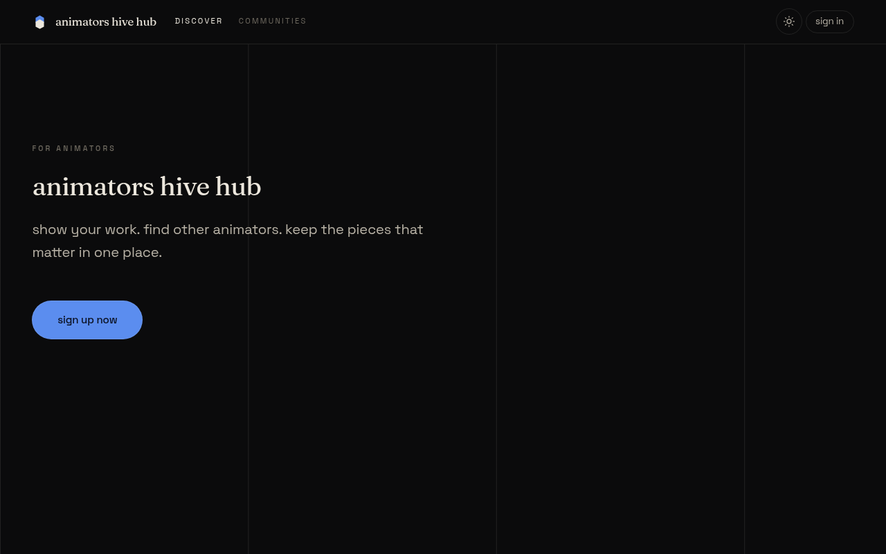

*Figure 13: Landing page*

The landing page is the first screen a visitor sees. It shows the heading animators hive hub and the line for animators.

1. Open the site at its web address.
2. To create an account, select sign up now. A dialog opens titled create an account.
3. To sign in instead, select sign in in the header. A dialog opens titled welcome back.

**E.2 Sign-up**

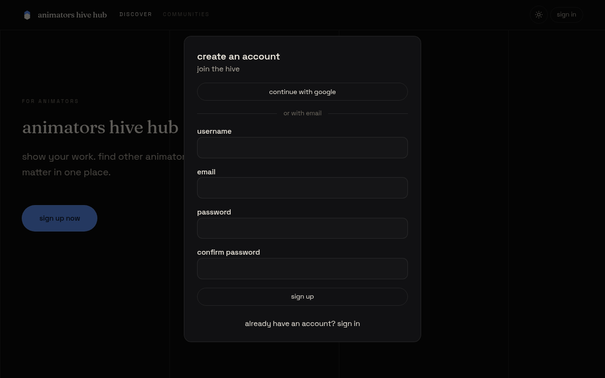

*Figure 14: Sign-up*

The sign-up dialog creates an account with an email address and a password, or with a Google account.

1. Select continue with google to create or sign in to an account with Google, or fill in the fields below it.
2. In username, enter three to 30 letters, numbers or underscores.
3. In email, enter your email address.
4. In password, enter at least six characters.
5. In confirm password, enter the same password again. If the two passwords differ, a message says so and nothing is sent.
6. Select sign up. A message says account created, and the discover heading appears.
7. To use an existing account, select already have an account? sign in, then enter email and password and select sign in.

**E.3 Discover feed**

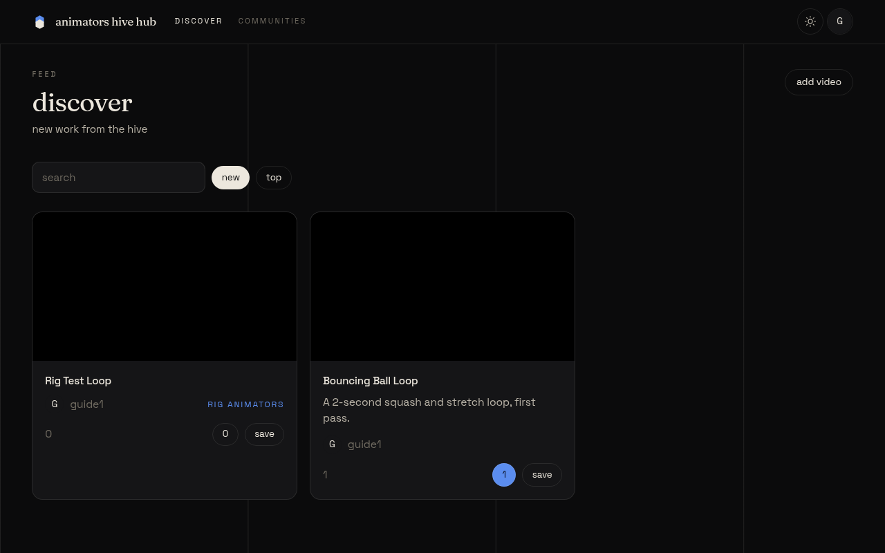

*Figure 15: Discover feed*

The discover feed is the home screen for a signed-in member. It shows new work from the community, newest first.

1. To find an animation, type a word into the search box labelled search. The list narrows to matching titles and descriptions.
2. Select new to list the newest animations, or top to list the most upvoted ones.
3. Select a card's title or picture to open its animation page.
4. Select load more at the foot of the list to see the next 20 animations.
5. On a card, the count button shows the number of upvotes, and the comment count is shown beside it.
6. Select save on a card to add the animation to one of your playlists (see E.6).
7. Select add video to upload a new animation (see E.4).

**E.4 Upload an animation**

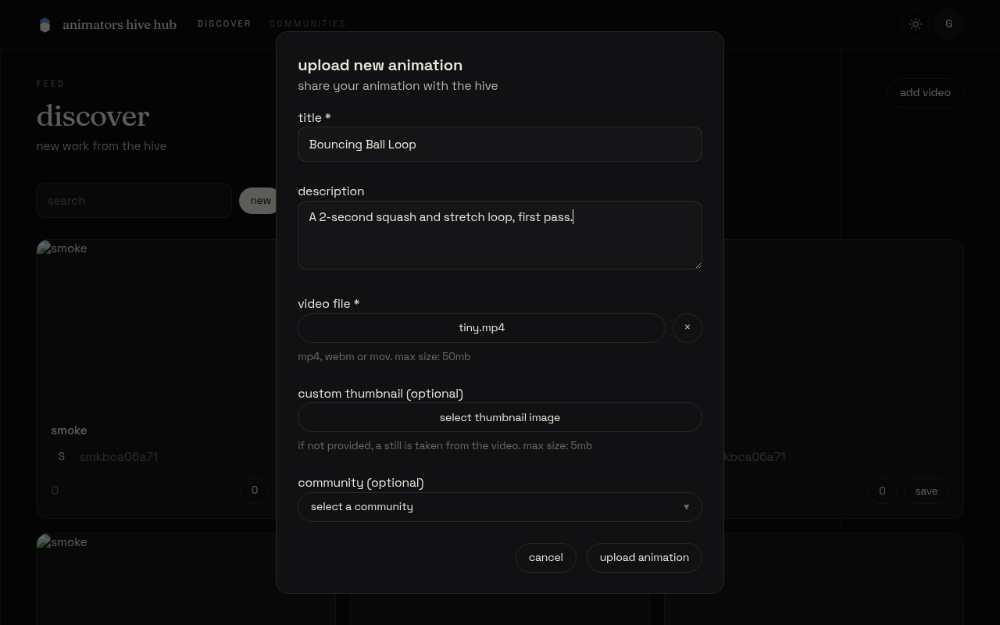

*Figure 16: Upload an animation*

Use this screen to share an animation. It opens from add video on the discover feed or the profile page.

1. In title, enter a title for the animation. The title is required.
2. In description, enter an optional description of up to 2,000 characters.
3. Select select video file, and choose an mp4, webm or mov file of up to 50 MB.
4. Optionally, select select thumbnail image and choose an image of up to 5 MB. If you do not choose one, a still is taken from the video.
5. Optionally, open community (optional) and choose a community. Choose no community to leave it out, or create new community to make one. For a new community, enter its name in new community name.
6. Select upload animation. The button shows the current step, such as uploading video, and the dialog closes when the animation is saved.
7. To leave without uploading, select cancel.

**E.5 Animation page: upvote and comment**

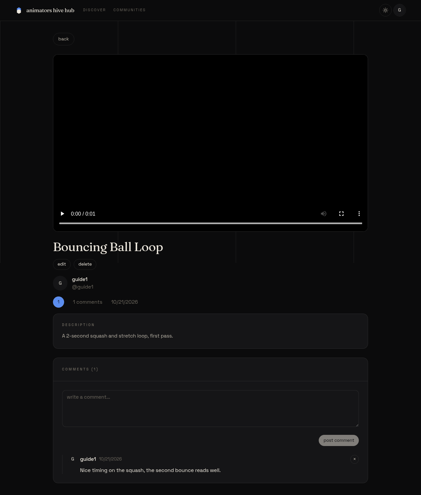

*Figure 17: Animation page: upvote and comment*

The animation page shows the video, its details and its comments.

1. Watch the video with the controls under the player.
2. To upvote, select the count button. It changes state and the count goes up by one. Select it again to remove your upvote. If you are not signed in, the message sign in to upvote appears instead.
3. To comment, type into the box labelled write a comment, then select post comment. Your comment appears at the top of the list.
4. To delete your own comment, select the × button beside it.
5. If you own the animation, select edit to change its title and description, then save. Select delete and confirm to remove it for good.
6. Select back to return to the previous screen.

**E.6 Playlists**

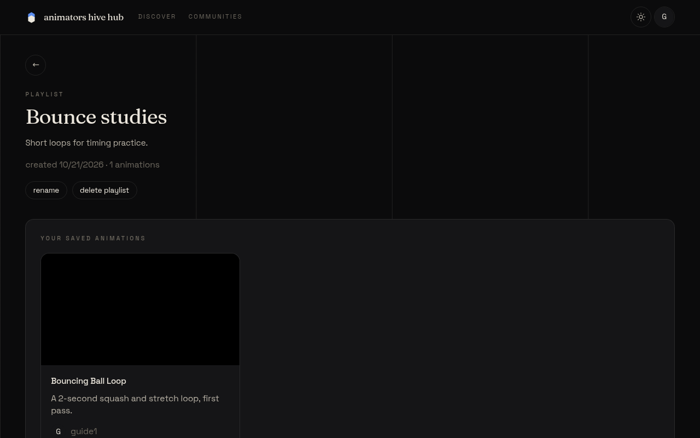

*Figure 18: Playlists*

Playlists group animations that you want to keep together. They are kept on your profile, under the playlists tab.

1. Open your profile and select the playlists tab.
2. Select create playlist. In the dialog, enter a name in name, and optionally a description in description (optional). Select create.
3. Select view playlist on a card to open the playlist.
4. To add an animation, select save on the animation's card. Choose a playlist in the list. If you have no playlists, the dialog says so.
5. On a playlist you own, select rename to change its name and description, and save. Select remove under an animation to take it out, and delete playlist to remove the playlist.

**E.7 Communities**

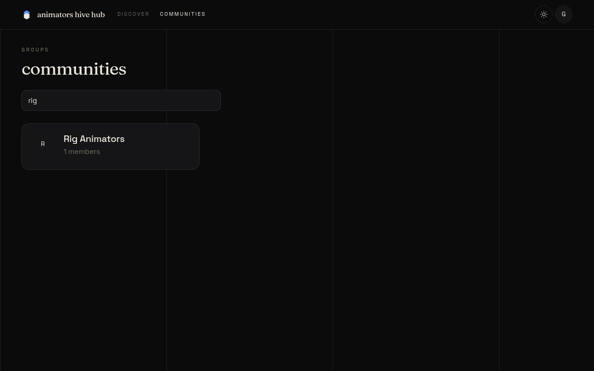

*Figure 19: Communities*

Communities gather animations on one theme. Anyone can browse them, and members can join.

1. Select communities in the header.
2. In the box labelled search communities, type part of a name to narrow the list.
3. Select a community to open its page. The member count is shown under its name.
4. If you are signed in, select join to become a member, or leave to stop being one. The count changes at once.
5. The community page shows its animations, with the same search and sort options as the discover feed.

**E.8 Your profile**

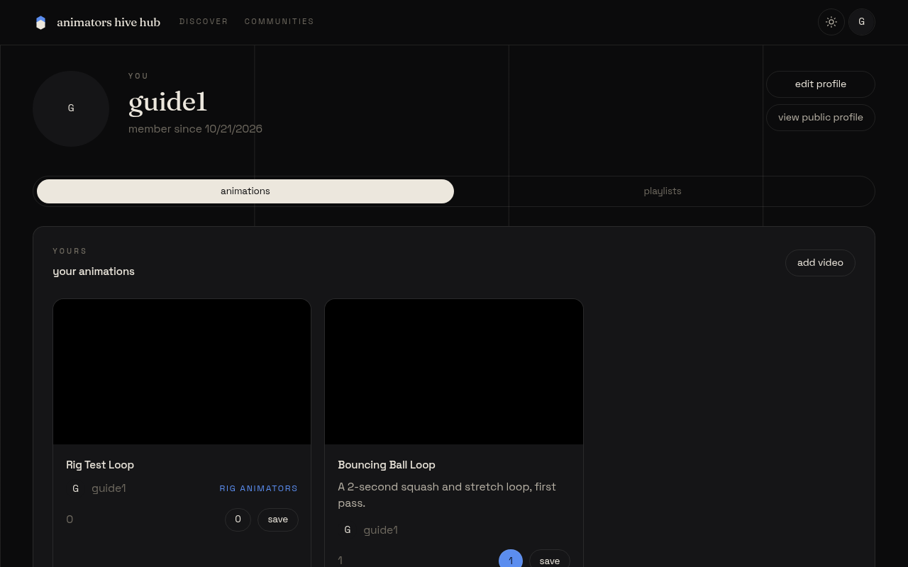

*Figure 20: Your profile*

Your profile shows your picture, display name, bio, location and website, and your work.

1. Open the account menu from your picture in the header, then select view profile.
2. Select edit profile to change your display name, bio, location, website and picture, then select save changes.
3. To change your password, open edit profile, enter your old password and a new one in the password section, and select change password. Other signed-in sessions will end. An account created with Google can set a password instead, with set password.
4. To delete your account, open edit profile, type your username in the delete account section, and select delete account. Confirm the message. This removes your animations, comments and playlists.
5. Select view public profile to see the page other people see.
6. Select the animations tab for your uploads, or the playlists tab for your playlists.

**E.9 Mobile view**

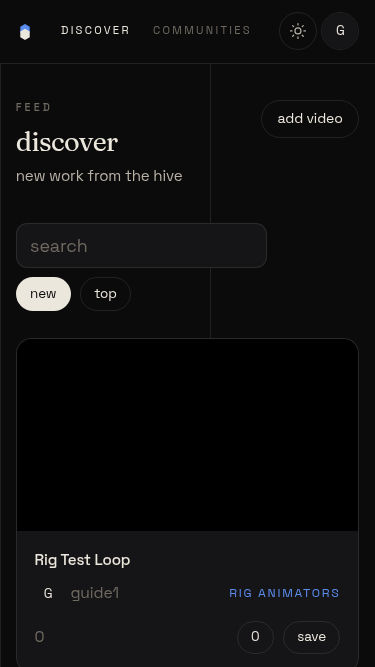

*Figure 21: Mobile view*

On a phone, the page fits the screen width and the header stays at the top.

1. The header shows discover and communities as links, and your picture as the account button. There is no hamburger menu.
2. Select the account button to see view profile, edit profile and sign out.
3. Scroll the page up and down. It does not scroll sideways.
4. If you are not signed in, the sign in button appears in the header.

### Appendix F: Source code overview

The source code is in the public repository at https://github.com/144126/animators-hive-hub. Figure 22 shows the full layout of the source tree. Table 19 gives one line for each of the key files.

**Figure 22: Full source tree**

```text
animators-hive-hub/
  docs/            proposal, diagrams, report and report images
  migrations/      0001_init.sql, 0002_sessions.sql, 0003_members.sql
  scripts/         smoke.ts
  src/
    app.css, app.d.ts, app.html, hooks.server.ts
    components/    Header, LandingPage, DiscoverFeed, AnimationCard,
                   AnimationDetailView, CommentsSection, UpvoteButton,
                   AddAnimationModal, FileUploadSection, CommunityCombobox,
                   AddToPlaylistModal, PlaylistsTab, UserAnimationsGrid,
                   Avatar, Modal, Toasts, auth/ (AuthModal, SignInForm, SignUpForm)
    lib/
      server/      db.ts, session.ts, oauth.ts
      util/oauth/  google_redirect_uri.ts
      auth.svelte.ts, data.ts, http.ts, rules.ts, theme.svelte.ts,
      toast.svelte.ts, types.ts, upload.ts, utils.ts
    routes/
      +page, +layout, +error, discover at /, animation/[animationId],
      c/[communityName], communities, u/[username], profile, profile/edit,
      playlist/[playlistId], login/google, google, media/[k],
      api/animations, api/animations/[id], api/auth/signup, api/auth/signin,
      api/auth/signout, api/auth/password, api/comments, api/communities,
      api/communities/[name], api/communities/[name]/join, api/me,
      api/media, api/playlist-items, api/playlists, api/playlists/[id],
      api/profile, api/upvotes
  static/          favicon.ico, logo.svg, robots.txt
  tests/           core.e2e.ts, mobile.e2e.ts, fixtures/tiny.mp4
  wip-plans/, plan/ plan files and logs
  package.json, pnpm-lock.yaml, pnpm-workspace.yaml, svelte.config.js,
  vite.config.ts, tsconfig.json, eslint.config.js, prettier.config.js,
  e2e.config.ts, wrangler.jsonc, .node-version, .env.example, README.md
```

**Table 19: Key source files**

| File | Purpose |
|---|---|
| src/hooks.server.ts | Reads the session on each request and applies the rate limits |
| src/lib/server/db.ts | All SQL, one function per query, with ownership results |
| src/lib/server/session.ts | Password hashing, session tokens, cookies and JSON responses |
| src/lib/server/oauth.ts | Builds the Google client from the environment |
| src/lib/rules.ts | Shared validation limits and checks, used by server and client |
| src/routes/login/google/+server.ts | Starts Google sign-in with state and PKCE cookies |
| src/routes/google/+server.ts | Handles the Google callback and creates or finds the account |
| src/routes/api/animations/+server.ts | Lists and creates animations |
| src/routes/api/media/+server.ts | Stores uploaded video and image files in R2 |
| src/routes/media/[k]/+server.ts | Serves stored media with range support |
| src/routes/api/upvotes/+server.ts | Reads and toggles an upvote |
| src/routes/api/comments/+server.ts | Lists, posts and deletes comments |
| src/routes/api/playlist-items/+server.ts | Adds and removes playlist items |
| src/routes/api/communities/[name]/join/+server.ts | Joins and leaves a community |
| src/components/AddAnimationModal.svelte | The upload dialog and its steps |
| src/components/Modal.svelte | Shared dialog with focus trap and Escape handling |
| src/lib/upload.ts | Uploads a file and captures a still frame from a video |
| migrations/0001_init.sql | Core tables, column comments and indexes |
| migrations/0002_sessions.sql | The session table |
| migrations/0003_members.sql | The membership table and its backfill |
| wrangler.jsonc | Worker name, D1 and R2 bindings, and rate limit settings |
| svelte.config.js | SvelteKit configuration with the Cloudflare adapter |
| scripts/smoke.ts | API smoke test run with node |
| tests/core.e2e.ts | Three browser tests for landing, sign-in focus, and sign-up with upload |
| tests/mobile.e2e.ts | Phone-width layout test |
| package.json | Scripts and dependency ranges |
